# ShopEase – Landing Page

**Tugas Pertemuan 10**

| | |
| :-- | :-- |
| Mata kuliah | Pemrograman Berbasis Kerangka Kerja (PBKK) |
| Pertemuan | 10 |
| Studi kasus | ShopEase |
| Framework | CodeIgniter 4 |
| Nama | *Andie Azril Alfrianto* |
| NRP | *5025241054* |

## Penjelasan tugas

Tugas pertemuan 10 adalah membuat **halaman landing page** untuk aplikasi toko online ShopEase, sesuai deskripsi di dokumen PRD dan Studi Kasus. Pengerjaannya dilakukan dengan memodifikasi tiga bagian utama pola MVC di CodeIgniter 4:

1. **Routing.** Di `app/Config/Routes.php`, URL halaman utama `/` diarahkan ke `HomeController::index`.
2. **Controller.** `HomeController` menyiapkan data yang ditampilkan di landing page: kategori, produk terbaru, produk terlaris, banner promosi, dan contoh struk pesanan.
3. **View.** Halaman disusun dari layout utama (`layouts/main.php`), navbar, footer, isi landing page (`frontend/home.php`), dan komponen kartu produk.

Isi landing page mengikuti kebutuhan homepage di Studi Kasus bagian 4.1: banner promosi, kategori produk, produk terbaru, produk terlaris, navigasi, dan tautan ke halaman katalog. Tampilan dibuat dengan Bootstrap 5 dan responsif, jadi bisa dibuka di desktop maupun HP.

Pada tahap ini data produk masih berupa data contoh di controller, jadi landing page bisa dijalankan tanpa database. Foto produk diambil dari Unsplash dan disimpan di `public/uploads/products/`.

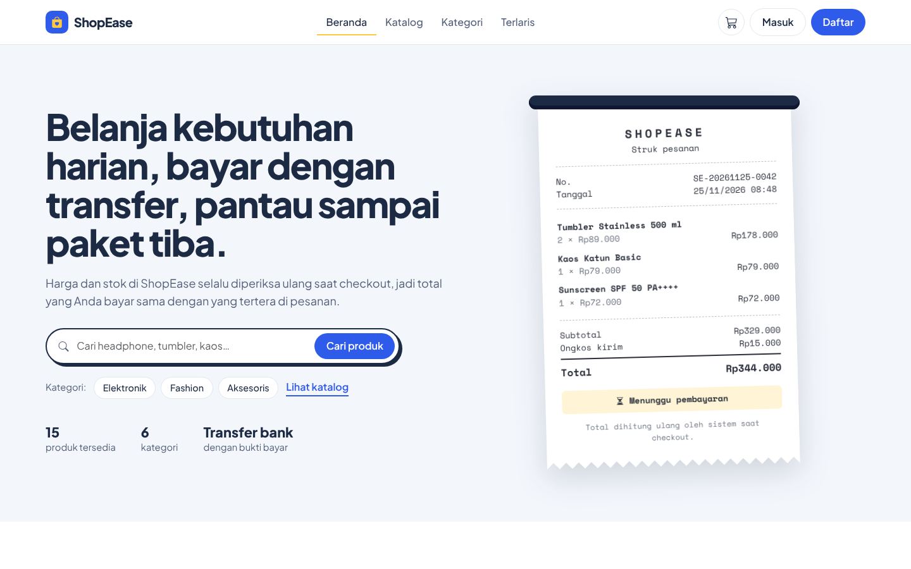

## Isi landing page (Studi Kasus 4.1 – Homepage)

| Yang diminta | Implementasi |
| :-- | :-- |
| Banner promosi | Banner utama (hero) dan 2 banner promosi kategori |
| Kategori produk | 6 kartu kategori beserta jumlah produk |
| Produk terbaru | 8 produk terbaru berdasarkan `created_at` |
| Produk terlaris | 4 produk dengan jumlah terjual terbanyak |
| Navigasi | Navbar: Beranda, Katalog, Kategori, Terlaris, keranjang, Masuk/Daftar |
| Tautan ke katalog | Form pencarian, chip kategori, dan tautan "Lihat katalog" / "Buka katalog" |

Produk berstatus `inactive` tidak ditampilkan (PRD BR-002), dan semua data di view di-escape dengan `esc()`.

Setiap produk punya foto di `public/uploads/products/`, dan nama filenya disimpan di kolom `image` pada data produk. Jika file gambar tidak ditemukan, kartu produk otomatis menampilkan ikon kategori sebagai pengganti.

## Struktur file

```
app/
├── Config/Routes.php                    ← route halaman utama
├── Controllers/HomeController.php       ← menyiapkan data landing page
├── Helpers/shopease_helper.php          ← format_rupiah(), category_style(), product_image_url()
└── Views/
    ├── layouts/
    │   ├── main.php                     ← layout utama (Bootstrap 5)
    │   └── partials/
    │       ├── navbar.php
    │       └── footer.php
    └── frontend/
        ├── home.php                     ← isi landing page
        └── partials/product_card.php    ← kartu produk
public/
├── assets/css/shopease.css              ← tema ShopEase
└── uploads/products/                    ← 15 foto produk (.jpg, 640×640)
```

## Cara pemasangan

1. Buat project CI4:
   ```bash
   composer create-project codeigniter4/appstarter shopease
   cd shopease
   ```
2. Salin folder `app/` dan `public/` dari paket ini ke root project, termasuk `public/uploads/products/`. Izinkan `Routes.php` ditimpa.
3. Salin `env` menjadi `.env`, lalu isi:
   ```ini
   CI_ENVIRONMENT = development
   app.baseURL = 'http://localhost:8080/'
   app.indexPage = ''
   app.appTimezone = 'Asia/Jakarta'
   ```
4. Jalankan `php spark serve`, lalu buka <http://localhost:8080>.

Landing page ini belum membutuhkan database. Bootstrap, ikon, dan font dimuat dari CDN, jadi perlu koneksi internet.

## Routing, controller, dan view

**Routing** – `app/Config/Routes.php`

```php
$routes->get('/', 'HomeController::index');
```

**Controller** – `HomeController::index()`:

1. Menyaring produk nonaktif.
2. Menghitung jumlah produk dan harga termurah per kategori.
3. Mengurutkan produk terbaru dan produk terlaris.
4. Menghitung contoh struk (subtotal = harga × qty, total = subtotal + ongkir).
5. Mengirim semua data ke `view('frontend/home', $data)`.

Data kategori dan produk ada di `getCategories()` dan `getProducts()`. Kolomnya mengikuti tabel `products` di Studi Kasus 5.2, jadi nanti cukup diganti dengan query dari model.

**View**

- `frontend/home.php` memakai `$this->extend('layouts/main')`.
- Navbar dan footer dimasukkan lewat `$this->include()`.
- Kartu produk dipanggil dengan `view('frontend/partials/product_card', [...])` untuk section terbaru dan terlaris.

## Sumber foto produk

Semua foto produk diambil dari [Unsplash](https://unsplash.com) dan boleh dipakai gratis sesuai [Lisensi Unsplash](https://unsplash.com/license). Foto sudah dipotong persegi 640×640 px.

| File | Produk | Sumber |
| :-- | :-- | :-- |
| `wireless-headphone.jpg` | Wireless Headphone | [images.unsplash.com/photo-1505740420928-5e560c06d30e](https://images.unsplash.com/photo-1505740420928-5e560c06d30e) |
| `smart-watch.jpg` | Smart Watch | [images.unsplash.com/photo-1523275335684-37898b6baf30](https://images.unsplash.com/photo-1523275335684-37898b6baf30) |
| `kaos-katun-basic.jpg` | Kaos Katun Basic | [images.unsplash.com/photo-1521572163474-6864f9cf17ab](https://images.unsplash.com/photo-1521572163474-6864f9cf17ab) |
| `topi-baseball-polos.jpg` | Topi Baseball Polos | [images.unsplash.com/photo-1588850561407-ed78c282e89b](https://images.unsplash.com/photo-1588850561407-ed78c282e89b) |
| `tumbler-stainless.jpg` | Tumbler Stainless 500 ml | [images.unsplash.com/photo-1602143407151-7111542de6e8](https://images.unsplash.com/photo-1602143407151-7111542de6e8) |
| `sneakers-casual.jpg` | Sneakers Casual | [images.unsplash.com/photo-1544441892-794166f1e3be](https://images.unsplash.com/photo-1544441892-794166f1e3be) |
| `sunscreen-spf-50.jpg` | Sunscreen SPF 50 PA++++ | [images.unsplash.com/photo-1738721796993-5f42d9315689](https://images.unsplash.com/photo-1738721796993-5f42d9315689) |
| `power-bank.jpg` | Power Bank 10.000 mAh | [images.unsplash.com/photo-1760708825913-65a50b3dc39b](https://images.unsplash.com/photo-1760708825913-65a50b3dc39b) |
| `matras-yoga.jpg` | Matras Yoga 6 mm | [images.unsplash.com/photo-1646239646963-b0b9be56d6b5](https://images.unsplash.com/photo-1646239646963-b0b9be56d6b5) |
| `tas-tote-kanvas.jpg` | Tas Tote Kanvas | [images.unsplash.com/photo-1544816155-12df9643f363](https://images.unsplash.com/photo-1544816155-12df9643f363) |
| `earbuds-nirkabel-pro.jpg` | Earbuds Nirkabel Pro | [images.unsplash.com/photo-1606220588913-b3aacb4d2f46](https://images.unsplash.com/photo-1606220588913-b3aacb4d2f46) |
| `sabun-wajah-gentle.jpg` | Sabun Wajah Gentle | [images.unsplash.com/photo-1748639320154-6ba118bccc74](https://images.unsplash.com/photo-1748639320154-6ba118bccc74) |
| `kemeja-linen.jpg` | Kemeja Linen Lengan Panjang | [images.unsplash.com/photo-1740711152088-88a009e877bb](https://images.unsplash.com/photo-1740711152088-88a009e877bb) |
| `set-toples-kaca.jpg` | Set Toples Kaca Kedap Udara | [images.unsplash.com/photo-1621318551436-68573392fd5c](https://images.unsplash.com/photo-1621318551436-68573392fd5c) |
| `botol-minum-olahraga.jpg` | Botol Minum Olahraga 1 L | [images.unsplash.com/photo-1544003484-3cd181d17917](https://images.unsplash.com/photo-1544003484-3cd181d17917) |

## Screenshot

### Desktop

**Banner utama**


**Kategori produk**

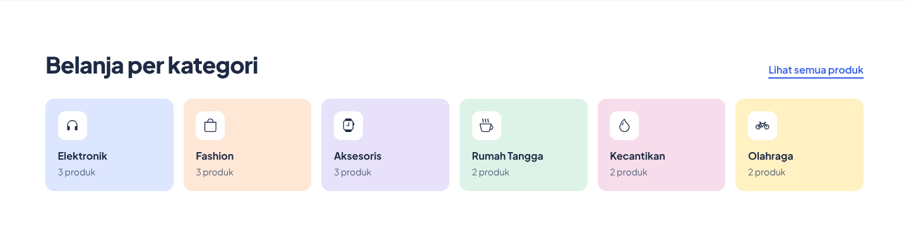

**Banner promosi**

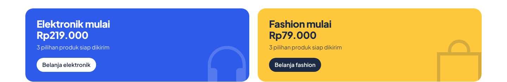

**Produk terbaru**

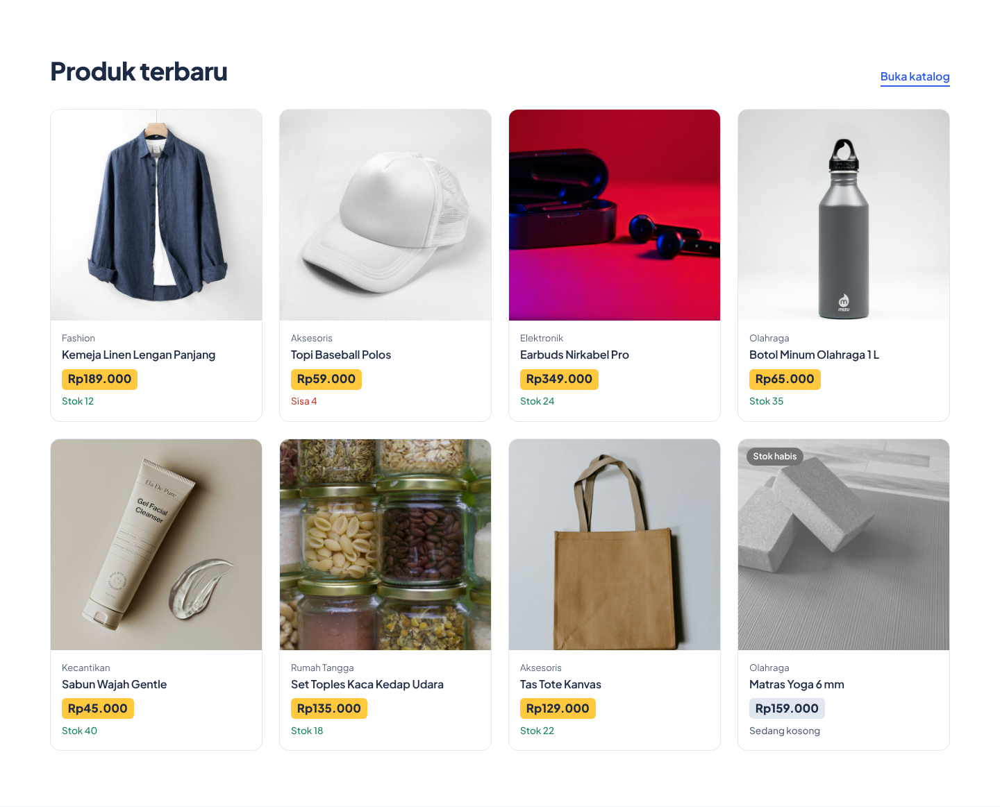

**Produk terlaris**

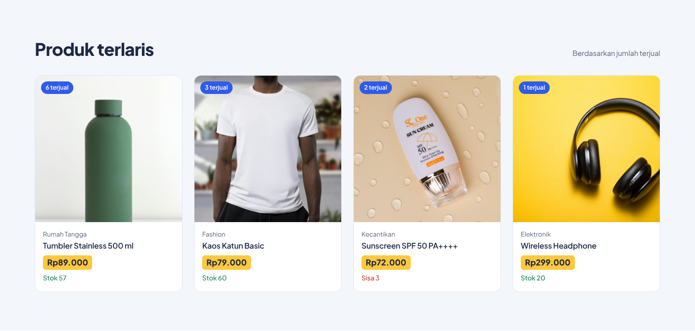

**Cara belanja**

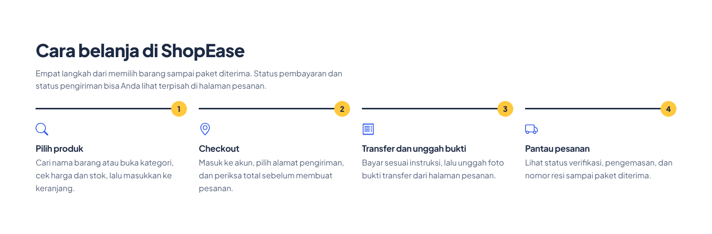

**Ajakan daftar dan footer**

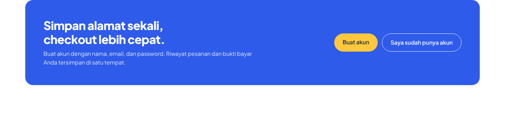

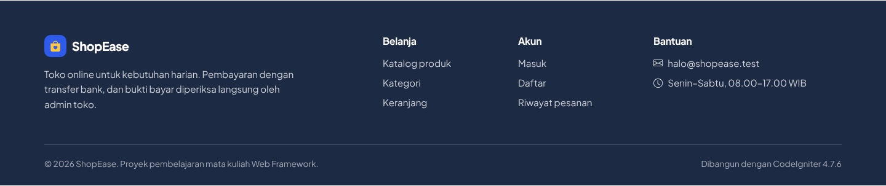

<details>
<summary>Lihat halaman penuh</summary>

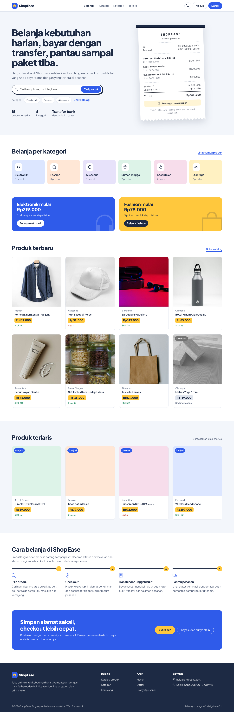

</details>

### Mobile (390 px)

<table>
  <tr>
    <td align="center">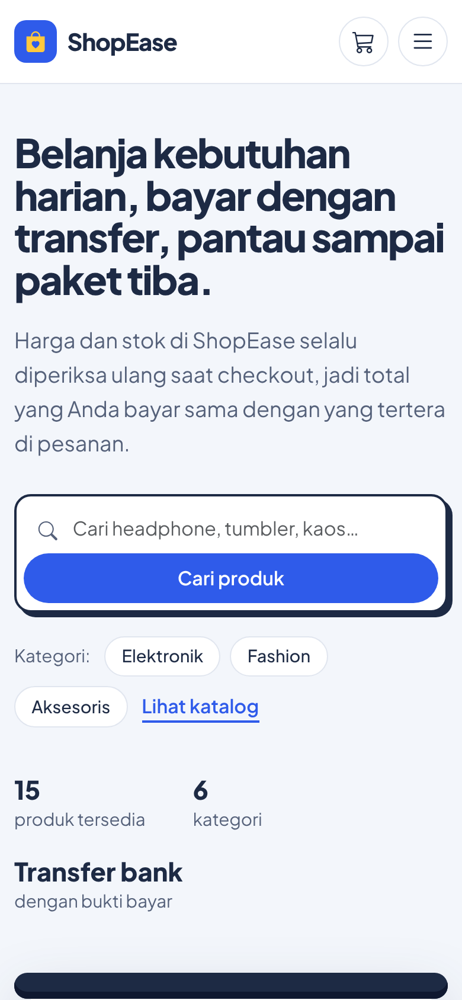<br>Tampilan awal</td>
    <td align="center">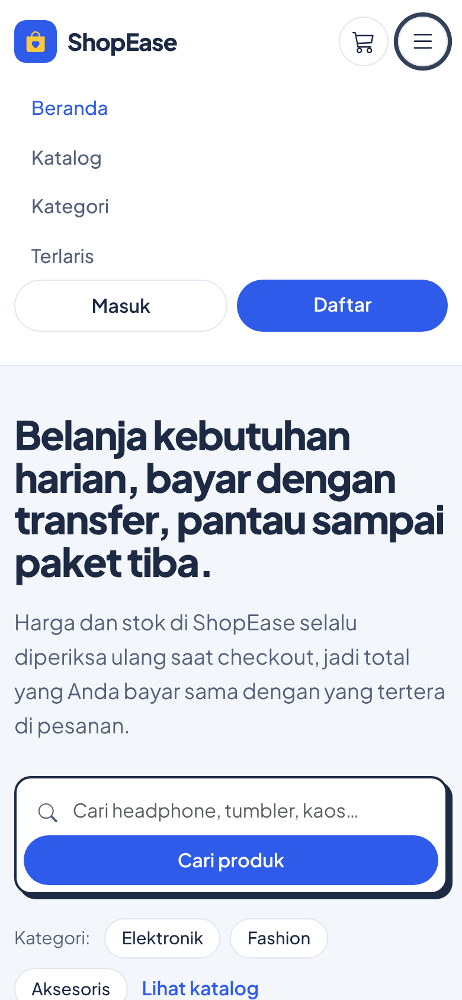<br>Menu navigasi</td>
  </tr>
</table>

<details>
<summary>Lihat halaman penuh di HP</summary>


</details>

---

<sub>ShopEase – proyek pembelajaran mata kuliah Web Framework. Data produk dan kontak adalah data contoh.</sub>
