# ShopEase – Authentication & MVC

**Tugas Pertemuan 11**

| | |
| :-- | :-- |
| Mata kuliah | Pemrograman Berbasis Kerangka Kerja (PBKK) |
| Pertemuan | 11 |
| Studi kasus | ShopEase |
| Framework | CodeIgniter 4 |
| Nama | Andie Azril Alfrianto |
| NRP | 5025241054 |

## Penjelasan tugas

Tugas pertemuan 11 melanjutkan landing page dari pertemuan 10 dengan dua bagian:

1. **Sistem autentikasi:** registrasi customer, login, logout, password hashing, session, dan pembatasan halaman berdasarkan role dengan `AuthFilter`.
2. **Kerangka MVC** untuk seluruh modul toko: produk, keranjang, checkout, pesanan, dan halaman admin. Setiap controller sudah punya route dengan filter role yang sesuai. Halaman **katalog dan detail produk sudah berfungsi**: pencarian, filter kategori, urutan harga, dan pagination. Halaman lain (keranjang, checkout, pesanan, admin pesanan) masih berupa kerangka dan dikerjakan di pertemuan berikutnya.

Data produk sekarang disimpan di database dan diakses lewat `ProductModel` dan `CategoryModel`. Controller tidak lagi menyimpan data atau query: query ada di model, tampilan ada di view, dan controller hanya mengatur alurnya.

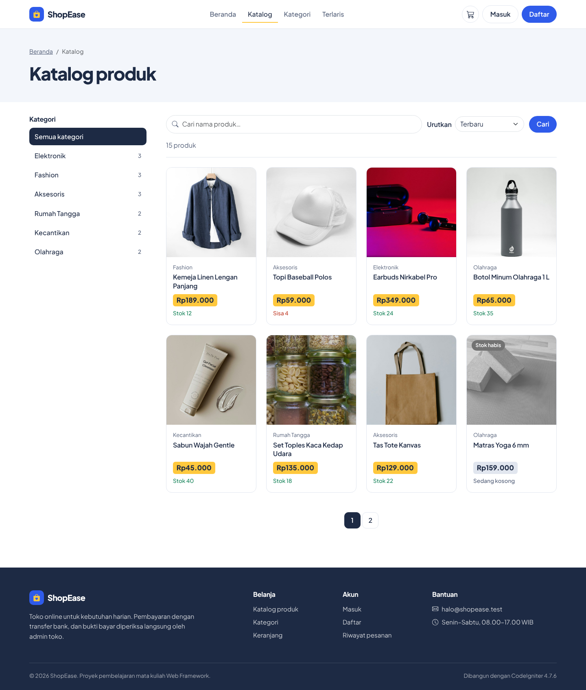

## Perubahan dari pertemuan 10

**File baru**

```
app/
├── Controllers/
│   ├── AuthController.php               ← registrasi, login, logout
│   ├── ProductController.php            ← katalog & detail produk (berfungsi)
│   ├── CartController.php               ← kerangka keranjang + validasi tambah item
│   ├── CheckoutController.php           ← kerangka
│   ├── OrderController.php              ← kerangka riwayat & detail pesanan
│   └── Admin/
│       ├── DashboardController.php      ← dashboard admin/operator
│       ├── ProductController.php        ← daftar produk dari database (CRUD menyusul)
│       └── OrderController.php          ← kerangka
├── Filters/AuthFilter.php               ← cek login dan role
├── Models/
│   ├── UserModel.php                    ← tabel users, hash password otomatis
│   ├── CategoryModel.php                ← kategori + jumlah produk
│   └── ProductModel.php                 ← produk aktif, terbaru, terlaris, filter katalog
└── Views/
    ├── auth/login.php, register.php, _password_toggle.php
    ├── frontend/catalog.php, product_detail.php, cart.php, checkout.php
    ├── frontend/orders/index.php, detail.php
    ├── admin/_nav.php, dashboard.php
    ├── admin/products/index.php, admin/orders/index.php
    ├── layouts/partials/flash.php       ← pesan sukses/gagal
    ├── layouts/partials/todo.php        ← penanda halaman kerangka
    └── pager/bootstrap.php              ← tampilan pagination Bootstrap 5
database/
└── db_shopease.sql                      ← tabel users, categories, products + data awal
```

**File yang diubah**

| File | Perubahan |
| :-- | :-- |
| `app/Config/Routes.php` | Route untuk semua halaman + grup dengan filter role (lihat tabel Route) |
| `app/Config/Filters.php` | Alias `auth` → `AuthFilter`, dan filter `csrf` aktif untuk semua request |
| `app/Config/Pager.php` | Mendaftarkan template pagination `bootstrap` |
| `app/Controllers/HomeController.php` | Data landing page diambil dari `ProductModel` dan `CategoryModel` (sebelumnya array di controller) |
| `app/Views/layouts/main.php` | Menampilkan pesan flash di bawah navbar |
| `app/Views/layouts/partials/navbar.php` | Menu akun setelah login, tombol Keluar via POST + CSRF |
| `public/assets/css/shopease.css` | Gaya login/register, katalog, detail produk, pagination, halaman admin |

## Cara menjalankan

Langkah ini melanjutkan project dari pertemuan 10.

1. Salin folder `app/`, `public/`, dan `database/` dari paket ini ke folder project. Izinkan file yang sudah ada ditimpa.
2. Nyalakan **MySQL** di XAMPP, lalu import `database/db_shopease.sql` lewat phpMyAdmin (menu **Import**) atau terminal:
   ```bash
   mysql -u root -p < database/db_shopease.sql
   ```
   File ini membuat tabel `users`, `categories`, dan `products` beserta data awalnya. Aman di-import ulang.
3. Tambahkan pengaturan database berikut di `.env`:
   ```ini
   database.default.hostname = localhost
   database.default.database = db_shopease
   database.default.username = root
   database.default.password =
   database.default.DBDriver = MySQLi
   database.default.port = 3306
   ```
4. Jalankan `php spark serve`, lalu buka <http://localhost:8080>.

> Sekarang **landing page juga membutuhkan database**, karena datanya diambil dari tabel `products` dan `categories`.

## Akun demo

| Role | Email | Password | Setelah login |
| :-- | :-- | :-- | :-- |
| admin | admin@shopease.test | admin12345 | `/admin/dashboard` |
| operator | operator@shopease.test | operator12345 | `/admin/dashboard` |
| customer | customer@shopease.test | customer12345 | `/` (beranda) |

Akun customer baru bisa dibuat lewat `/register`. Akun admin dan operator hanya bisa dibuat langsung di database.

## Route

| Method | URL | Controller | Akses | Status |
| :-- | :-- | :-- | :-- | :-- |
| GET | `/` | `HomeController::index` | Publik | Berfungsi |
| GET | `/catalog` | `ProductController::catalog` | Publik |  Berfungsi |
| GET | `/product/(:num)` | `ProductController::detail/$1` | Publik |  Berfungsi |
| GET / POST | `/register` | `AuthController::register` / `store` | Publik |  Berfungsi |
| GET / POST | `/login` | `AuthController::login` / `attempt` | Publik |  Berfungsi |
| POST | `/logout` | `AuthController::logout` | `auth` |  Berfungsi |
| GET | `/cart` | `CartController::index` | `auth:customer` | Kerangka |
| POST | `/cart/add` | `CartController::add` | `auth:customer` | Validasi jalan, penyimpanan menyusul |
| GET | `/checkout` | `CheckoutController::index` | `auth:customer` | Kerangka |
| GET | `/orders` | `OrderController::index` | `auth:customer` | Kerangka |
| GET | `/orders/(:num)` | `OrderController::detail/$1` | `auth:customer` | Kerangka |
| GET | `/admin/dashboard` | `Admin\DashboardController::index` | `auth:admin,operator` |  Berfungsi |
| GET | `/admin/orders` | `Admin\OrderController::index` | `auth:admin,operator` | Kerangka |
| GET | `/admin/products` | `Admin\ProductController::index` | `auth:admin` | Daftar jalan, CRUD menyusul |

Operator bisa membuka dashboard dan pesanan, tetapi **tidak** bisa membuka manajemen produk. Admin dan operator tidak bisa membuka halaman keranjang/pesanan customer.

## Katalog & detail produk

**`ProductController::catalog`** membaca filter dari query string, contohnya `/catalog?keyword=kaos&category=fashion&sort=termurah&page=2`.

| Parameter | Fungsi |
| :-- | :-- |
| `keyword` | Mencari di nama dan deskripsi produk (`LIKE`) |
| `category` | Slug kategori, misalnya `elektronik` |
| `sort` | `terbaru` (bawaan), `termurah`, `termahal`, atau `nama` |
| `page` | Halaman, 8 produk per halaman (`paginate()` + `$pager`) |

- Hanya produk berstatus `active` yang tampil. Nilai `sort` atau `category` yang tidak dikenal diabaikan.
- Filter yang sedang aktif tetap terbawa saat pindah halaman atau ganti kategori.
- Query ada di `ProductModel::filter()`. Controller hanya meneruskan parameter, lalu memanggil `paginate()`.

**`ProductController::detail($id)`** menampilkan foto, kategori, harga, stok, deskripsi, form jumlah + tombol **Tambah ke keranjang**, dan produk lain di kategori yang sama.
- Produk nonaktif atau yang tidak ada → **404**.
- Stok habis → input jumlah dan tombol keranjang dinonaktifkan.

**`CartController::add`** sudah menjalankan validasi: jumlah minimal 1, produk harus aktif, dan jumlah tidak boleh melebihi stok. Menyimpan ke tabel `carts`/`cart_items` dikerjakan di pertemuan berikutnya. Tamu yang menekan tombol keranjang diarahkan ke login, lalu dikembalikan ke halaman produk.

## Autentikasi

**Registrasi** (`AuthController::store`)
1. Input divalidasi di server:
   - Nama: minimal 3 karakter.
   - Email: format valid dan belum terdaftar. Email disimpan dalam huruf kecil.
   - Password: minimal 8 karakter, dan konfirmasinya harus sama.
2. Role selalu diisi `customer` oleh server. Field `role` dari browser diabaikan.
3. Password di-hash dengan `password_hash()` lewat callback `beforeInsert` di `UserModel`.

**Login** (`AuthController::attempt`)
1. Password dicek dengan `password_verify()`. Email tidak terdaftar dan password salah memberi pesan yang sama: *"Email atau password salah."*
2. `session()->regenerate()` membuat ID session baru. Session diisi `user_id`, `name`, `email`, `role`, dan `logged_in`.
3. Admin/operator diarahkan ke dashboard, customer ke beranda, atau kembali ke halaman yang tadi diminta.
4. Percobaan login dibatasi **5 kali per menit per IP** (Throttler bawaan CI4).

**Logout** lewat form **POST** + token CSRF. Data login dihapus dan ID session diganti.

**AuthFilter**
- Belum login → ke `/login`.
- Role tidak diizinkan → ke beranda dengan pesan *"Akun Anda tidak memiliki akses"*. Pengecekan di server, jadi tetap berlaku walaupun URL diketik langsung.
- Dipakai di route: `['filter' => 'auth:customer']`, `'auth:admin,operator'`, `'auth:admin'`.

**CSRF** aktif untuk semua request. Form POST tanpa token ditolak dengan status 403.

## Hasil pengujian

Diuji dengan request HTTP sungguhan ke aplikasi yang berjalan (CodeIgniter 4.7.6, MariaDB 10.11). Hasilnya: **69 dari 69 pengecekan lulus** (28 autentikasi + 41 katalog, routing, dan role).

| No. | Skenario | Hasil |
| :-- | :-- | :-- |
| 1 | `/catalog` tanpa filter |  15 produk aktif, 8 per halaman, halaman 2 berisi 7, produk nonaktif tidak muncul |
| 2 | Cari `kaos` |  Hanya Kaos Katun Basic |
| 3 | Filter `fashion` |  3 produk aktif |
| 4 | Elektronik urut termurah / semua urut termahal |  Urutan harga benar |
| 5 | Filter + sort + keyword lalu pindah halaman |  Filter tetap terbawa |
| 6 | Kata kunci tanpa hasil, atau berisi `<script>` |  Pesan "Tidak ada produk yang cocok", input di-escape |
| 7 | Detail produk aktif / nonaktif / tidak ada / id bukan angka |  200 / 404 / 404 / 404 |
| 8 | Detail produk stok habis |  Tombol keranjang dinonaktifkan |
| 9 | Tambah ke keranjang: jumlah valid / melebihi stok / 0 / produk nonaktif |  Lolos / "Stok tidak mencukupi" / "Jumlah tidak valid" / ditolak |
| 10 | Tamu menekan Tambah ke keranjang |  Ke login, setelah login kembali ke halaman produk |
| 11 | Customer membuka `/cart`, `/checkout`, `/orders`, `/orders/5` |  200 |
| 12 | Customer membuka `/admin/dashboard`, `/admin/products`, `/admin/orders` |  Ditolak |
| 13 | Admin membuka `/admin/products`, `/admin/orders`; membuka `/cart` |  200, 200; `/cart` ditolak |
| 14 | Operator membuka `/admin/orders`; membuka `/admin/products` |  200; produk ditolak, menu Produk tidak tampil |
| 15 | Registrasi, login, logout, CSRF, throttle (dari pengujian autentikasi) |  28/28 lulus |
| 16 | Landing page setelah pindah ke database |  Tampil sama, 4 produk terlaris dari tabel `products` |

## Screenshot

**Katalog**


**Filter kategori Elektronik, urut harga termurah**

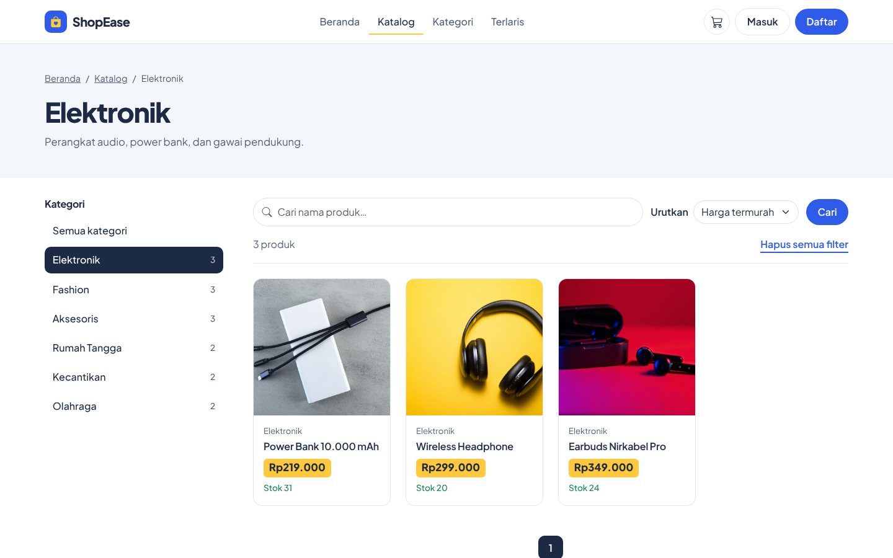

**Pencarian "botol"**

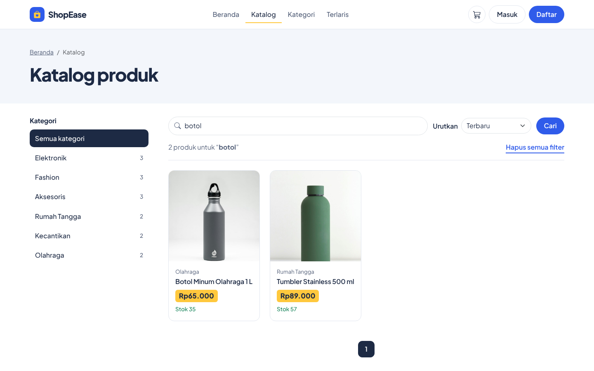

**Detail produk**

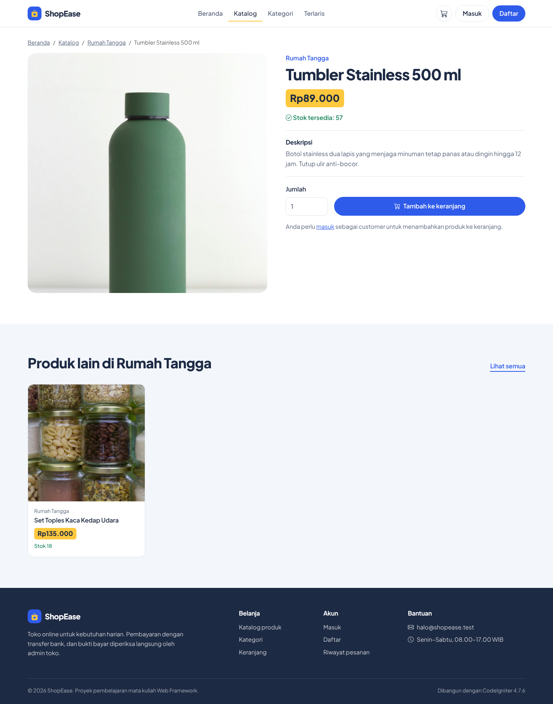

**Detail produk dengan stok habis**

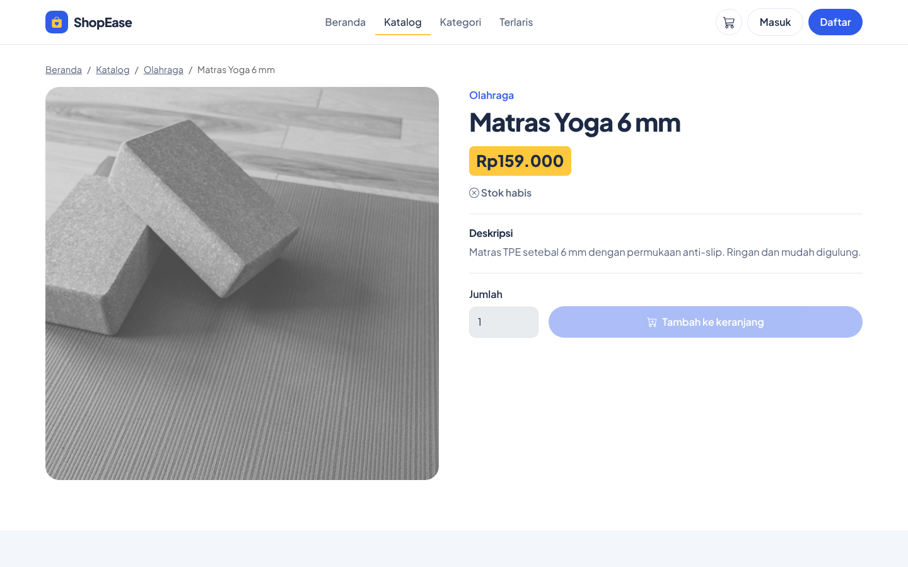

**Customer menambah 2 tumbler ke keranjang** (validasi lolos, halaman keranjang masih kerangka)

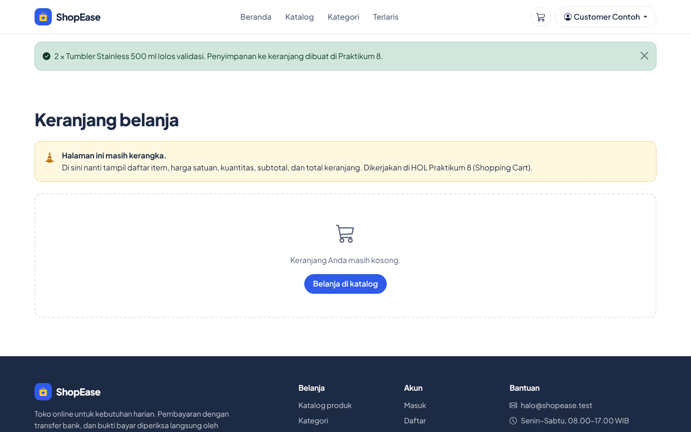

**Admin – daftar produk**

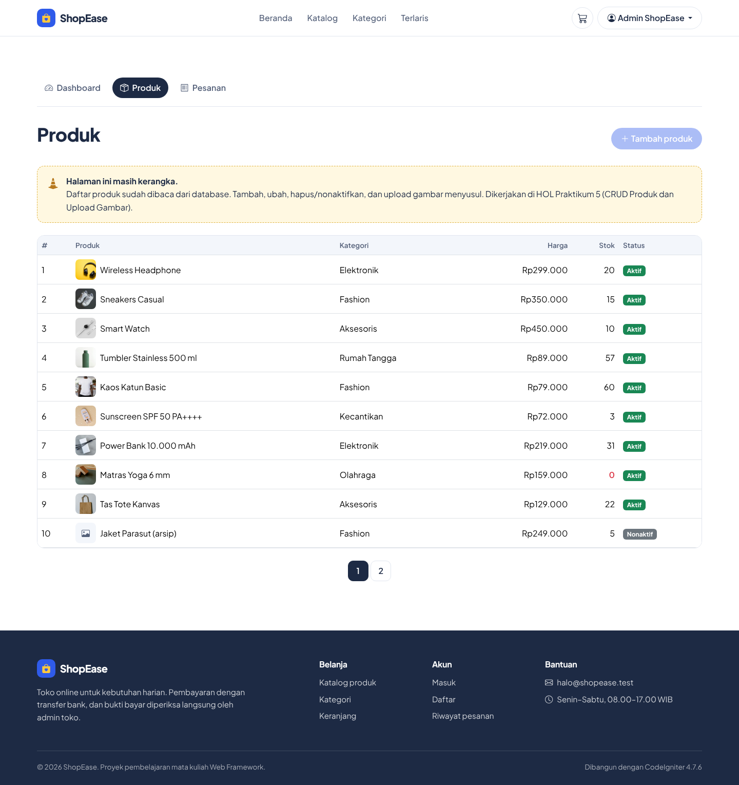

**Operator mencoba membuka manajemen produk**

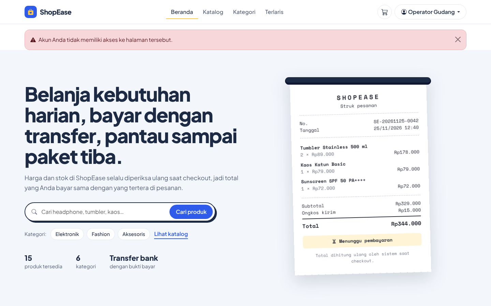

**Login dan validasi registrasi**

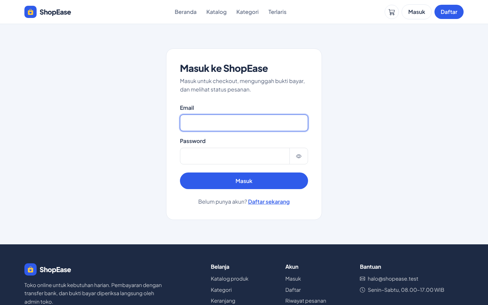

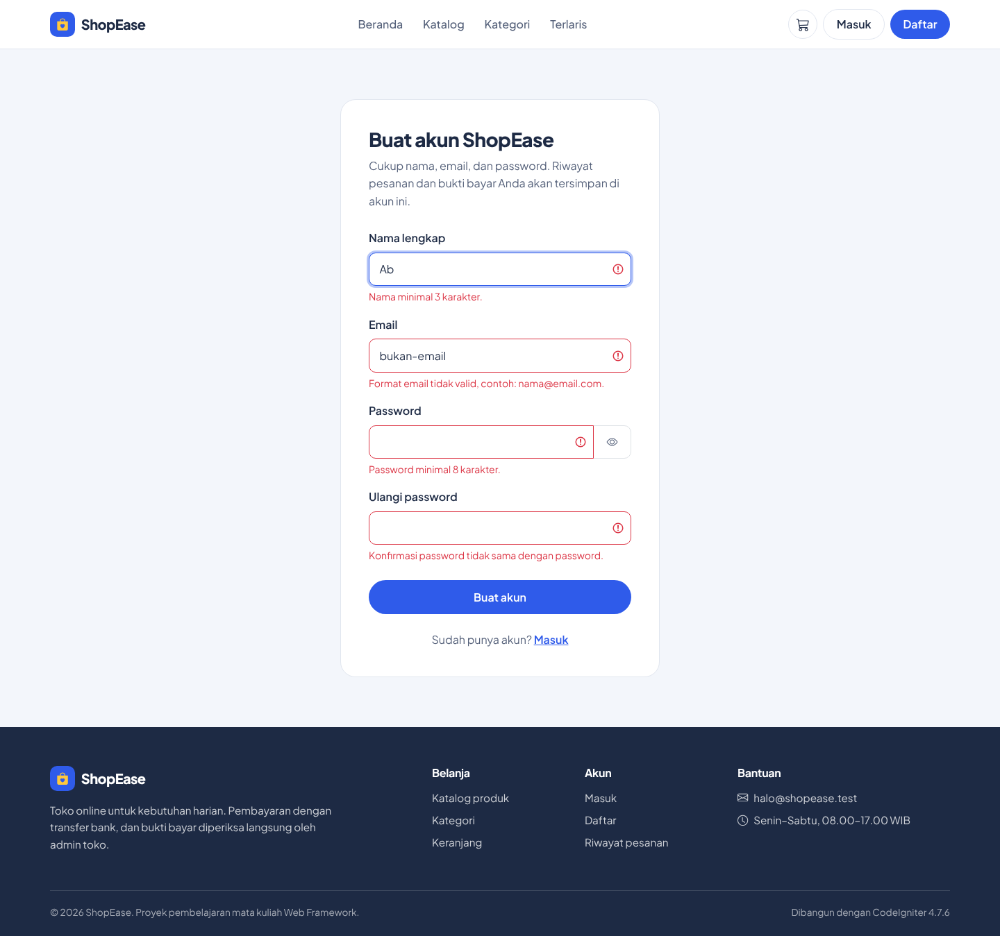

**Dashboard admin**

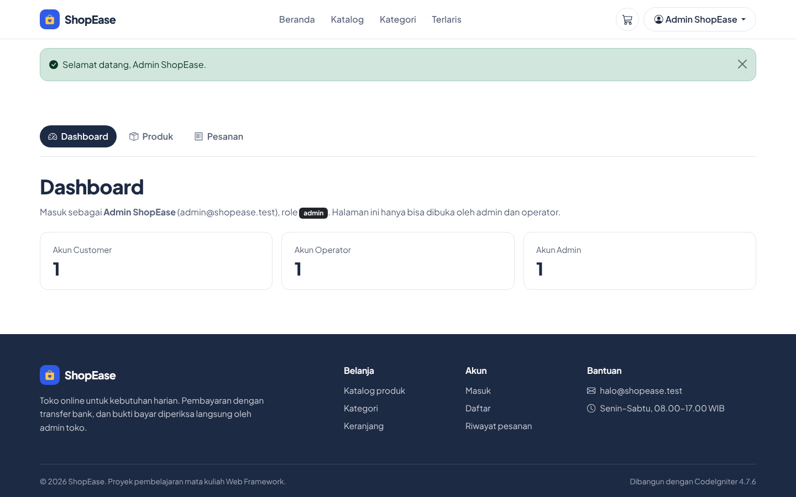

**Customer mencoba membuka `/admin/dashboard`**


**Tampilan HP – katalog dan detail produk**

<table>
  <tr>
    <td align="center">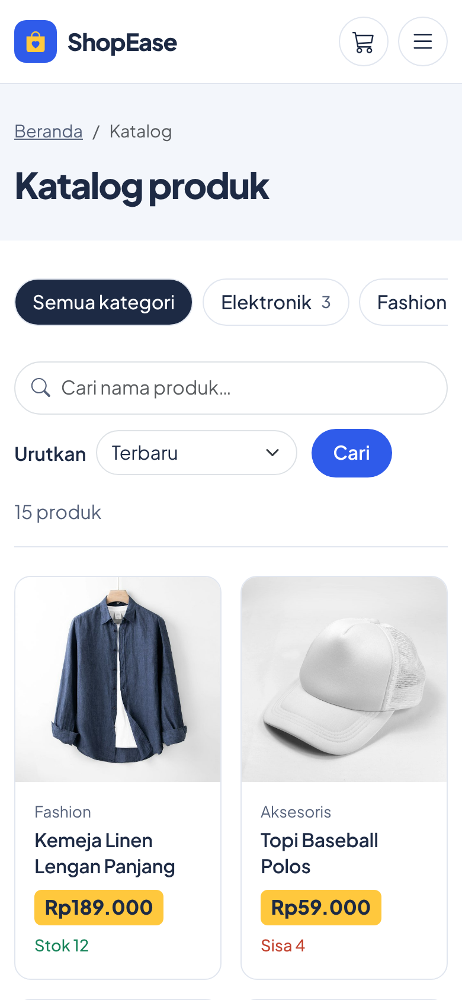<br>Katalog</td>
    <td align="center">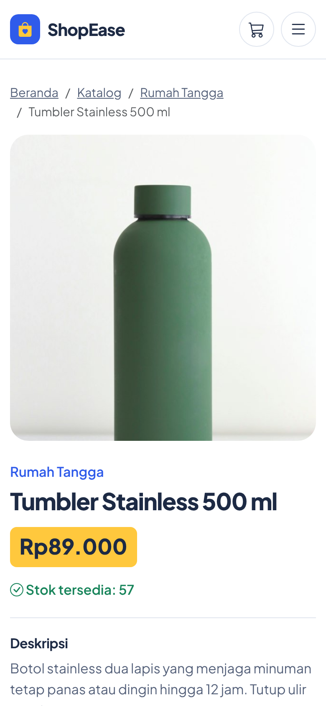<br>Detail produk</td>
  </tr>
</table>
